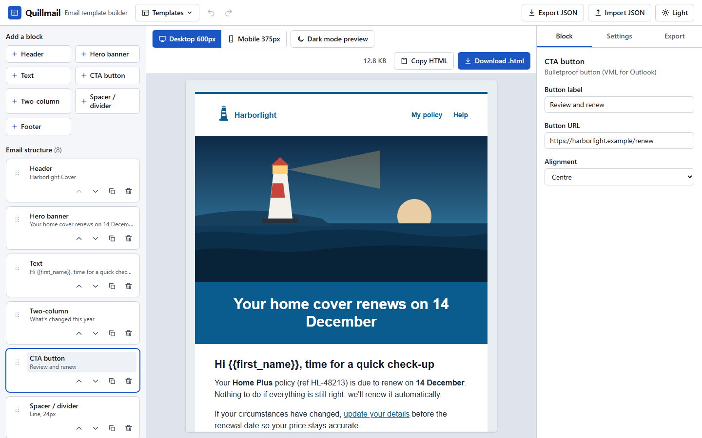
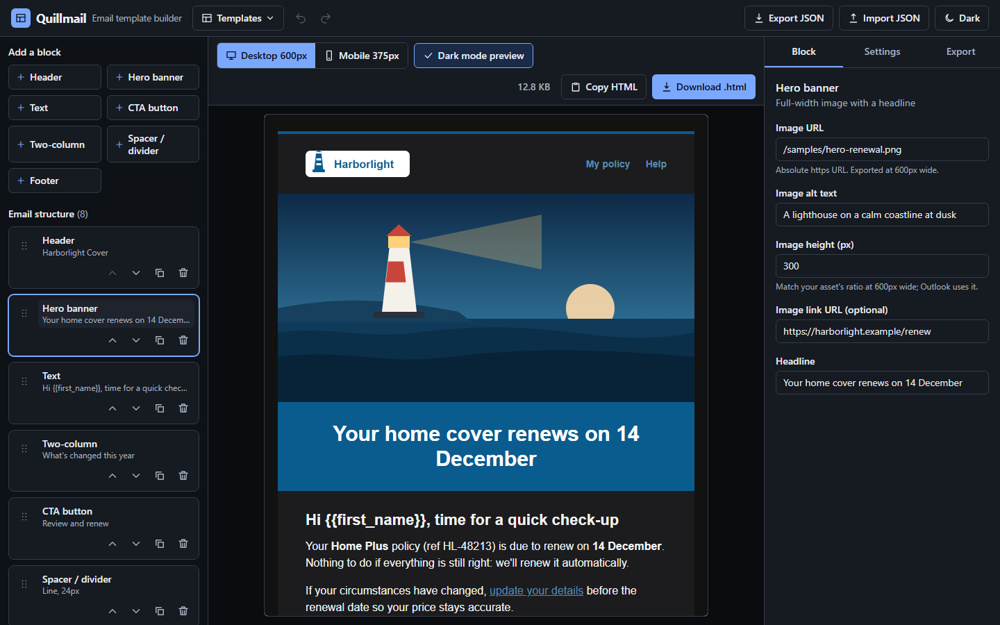
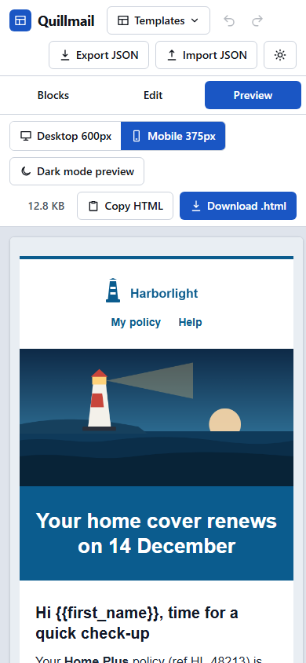
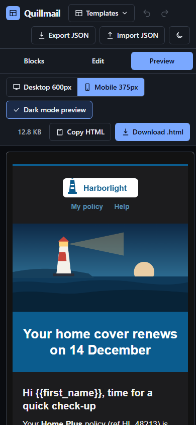
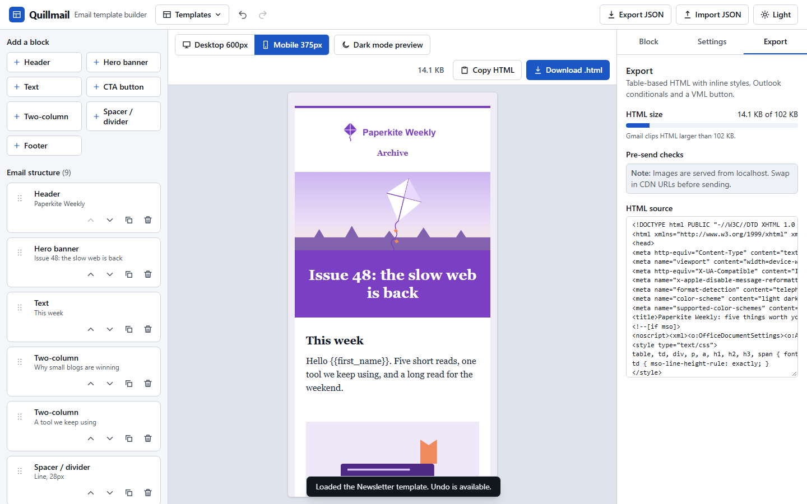

# Quillmail: email template builder & previewer

Drag-and-drop block editor that exports **production-style HTML email**: nested `role="presentation"` tables, inline styles, Outlook ghost tables and a VML button, a mobile stacking media query, dark-mode hooks and a Gmail 102 KB clipping check.

- Live demo: https://email-builder-omega-neon.vercel.app
- GitHub: https://github.com/a4abubakar/email-builder

| Light, desktop | Dark, desktop |
| --- | --- |
|  |  |

| Light, mobile | Dark, mobile |
| --- | --- |
|  |  |

Export panel with the size meter, pre-send checks and HTML source:



## Features

- **Seven blocks:** header (logo + nav), hero banner, text, CTA button, two-column, spacer/divider, footer (address, social, unsubscribe).
- **Editing:** add, select, edit in a side panel with labelled fields, duplicate, delete. Reorder by drag and drop (dnd-kit, pointer and keyboard sensors) or with **Move up / Move down** buttons.
- **Global settings:** subject, preheader, brand colour, background colour, web-safe font stack, fixed 600px width.
- **Live preview** in a sandboxed `srcDoc` iframe: Desktop 600px, Mobile 375px and an optional dark-mode preview.
- **Export:** *Copy HTML*, *Download .html*, plus the HTML source in the Export tab. The size in KB is always visible and warns at about 90% of Gmail's 102 KB clipping limit.
- **Pre-send checks:** missing preheader or alt text, invalid CTA URL, no unsubscribe link or postal address, `http` or localhost image URLs.
- **Starters:** Renewal reminder, Welcome, Newsletter (all fictional brands), or a blank email.
- **Persistence:** the document autosaves to `localStorage`; import and export it as JSON (imports are validated and sanitised). Undo and redo, with consecutive keystrokes in one field merged into a single step.
- **App chrome:** light, dark and system theme with no flash on load, responsive down to 360px with a Blocks / Edit / Preview switcher.

## What the exported HTML contains

`renderEmail(doc)` in `src/lib/email/render.ts` is a pure function: document in, string out.

- XHTML 1.0 Transitional doctype, `xmlns:v` / `xmlns:o` namespaces, `<meta>` for viewport, `x-apple-disable-message-reformatting`, `format-detection`, `color-scheme` and `supported-color-schemes`.
- Every layout table has `role="presentation"`, `cellpadding/cellspacing/border="0"`; background colours are set as both `bgcolor` and inline `background-color`.
- A 600px **ghost table** wrapper in `<!--[if mso]>` conditionals, so Outlook for Windows respects the width. The two-column block is a hybrid ("spongy") layout with its own ghost table.
- **Bulletproof CTA:** VML `<v:roundrect>` with `<w:anchorlock/>` for Outlook, and a plain styled `<a>` hidden from Outlook with `<!--[if !mso]><!-->`.
- Hidden **preheader** with zero-width padding so body copy doesn't leak into the inbox preview.
- Responsive `@media screen and (max-width: 620px)`: `.container`, `.px-m` padding, `.stack` (columns stack), `.img-fluid`, smaller headings.
- **Dark mode:** class hooks (`.dm-card`, `.dm-text`, ...) with a `prefers-color-scheme: dark` block, plus `[data-ogsc]` / `[data-ogsb]` selectors for Outlook.com. Brand-coloured bands keep their colour and their text colour is picked for contrast.
- Image `src` values are always absolute `http(s)`; each `` has `width`, `height`, `alt` and `display:block`. Root-relative sample paths are resolved against the app origin at export time.
- All user content is HTML-escaped; `href`s allow only `http(s)`, `mailto`, `tel`, `#` and a single ESP merge tag such as `{{unsubscribe_url}}`; colours and font stacks are validated before they reach a `style` attribute. Brand colours that fail WCAG contrast as link colours are darkened automatically.

## Tech stack

Next.js 16.4 (App Router) · React 19 · TypeScript (strict) · Tailwind CSS v4 · `@dnd-kit` · Vitest 5 + Testing Library · Playwright 1.65.

## Key decisions

- **A string template, not React Email or MJML.** The output is the product here, so I wanted complete control over every tag and zero hidden markup. The trade-off is that I own the Outlook quirks (VML width is estimated from the label length, for example).
- **Editor state is a pure reducer.** Ids are supplied by the caller, so `add / move / duplicate / delete / undo` are deterministic and unit tested without a DOM. Undo coalesces consecutive edits to the same field.
- **Dark preview is forced, not emulated.** An iframe can't be told to match `prefers-color-scheme: dark` independently of the host page, so the preview renders the same dark rules unconditionally. Real exports keep them inside the media query.
- **The preview is untrusted.** `sandbox=""` means no scripts, no forms and no navigation, even if escaping ever failed.
- **Client-only editor.** It reads `localStorage` and `window.location`, so the server renders a skeleton and the editor mounts after hydration (no hydration mismatches, no stored-state flash). The App Router `loading.tsx`, `error.tsx` (with "reset saved template") and `not-found.tsx` are in place.
- **Sample art is PNG, not SVG,** because email clients don't render SVG. `npm run samples` regenerates it.
- **Inline formatting is a tiny markup** (`**bold**`, `*italic*`, `[label](url)`) instead of a rich-text editor: it round-trips through JSON and can't inject markup.

## Project structure

```
src/
  app/                  layout (theme script, metadata), page, loading, error, not-found, icon
  components/           Builder (state + layout), BlockList (dnd-kit), BlockPalette, Inspector,
                        fields, Preview, ExportPanel, TemplateMenu, ThemeToggle, Icon
  lib/email/
    types.ts            document model
    blocks.ts           block defaults, field metadata (drives the side panel)
    render.ts           renderEmail(doc): the exporter
    reducer.ts          editor reducer with undo/redo
    size.ts             byte size and Gmail clipping level
    checks.ts           pre-send checks
    storage.ts          localStorage + JSON import validation
    templates.ts        starter templates
    color.ts            hex validation and WCAG contrast helpers
e2e/                    Playwright spec
scripts/                make-samples.mjs, screenshots.mjs
public/samples/         fictional sample art (PNG, 2x)
```

## How to run

```bash
npm install
npm run dev          # http://localhost:3003
npm test             # Vitest: renderEmail, reducer, size, import, components
npm run test:e2e     # Playwright (starts the dev server if it isn't running)
npm run lint && npm run build
npm run screenshots  # regenerates docs/screenshots (dev server must be running)
```

The Playwright config and the two scripts use `channel: "msedge"` because Playwright's bundled headless shell cannot launch on the machine this was built on. CI and other machines can drop that `channel` line (in `playwright.config.ts`, `scripts/screenshots.mjs` and `scripts/make-samples.mjs`) to use the default Chromium.

## Accessibility notes

- Landmarks: `header`, `main`, labelled `aside` / `section` regions, a "Skip to preview" link.
- Every field has a visible `<label>`; help text is wired up with `aria-describedby`; icon-only buttons have accessible names that include the block they act on ("Move Hero banner up").
- Dragging has a keyboard path in two forms: the dnd-kit keyboard sensor (Space to lift, arrows to move) and plain Move up / Move down buttons. Moves, adds and deletes are announced through a polite `aria-live` region; errors use `role="alert"`.
- The properties panel is a proper `tablist` with arrow-key navigation; the width and theme toggles expose `aria-pressed` / `aria-checked`; the size meter is `role="meter"`.
- Visible `:focus-visible` rings, AA contrast for both themes, and `prefers-reduced-motion` is respected.

## Testing

- **Unit (Vitest):** exporter structure (doctype, tables, MSO/VML, media query, dark rules, absolute images, balanced markup for every starter), escaping and XSS cases, preheader, reducer (add, move, duplicate, delete, undo/redo, coalescing), size calculation, import sanitising, pre-send checks, and three components.
- **E2E (Playwright):** load a starter, add a CTA, edit its label, see it in the preview iframe, switch to mobile (375px frame), copy HTML (clipboard contains the text and the VML button), download `.html`; reorder/duplicate/delete/undo; persistence across reload; dark preview and theme; no horizontal scroll at 360px.

## What I'd do next

- Render against real clients (Litmus / Email on Acid, and Outlook for Windows locally). The conditionals follow well-known patterns but are not verified in a real Outlook here.
- Image upload with automatic width/height detection (today you type the height) and a CDN adapter.
- Per-block dark-mode logo variants and a plain-text part generated from the same document.
- Custom blocks and ESP merge-tag validation (Liquid, Handlebars).
- Click-to-select in the preview, and a rich-text field that still exports safe markup.
